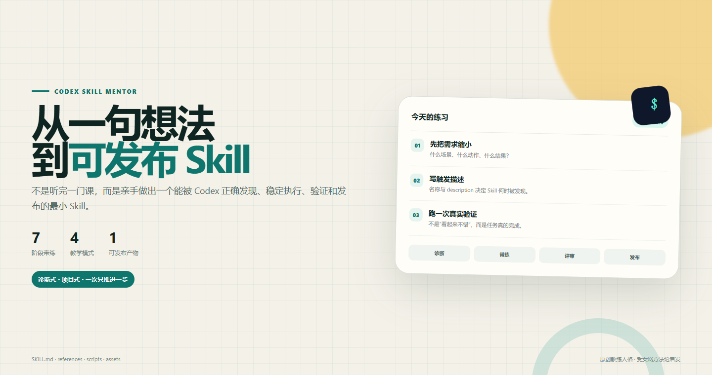
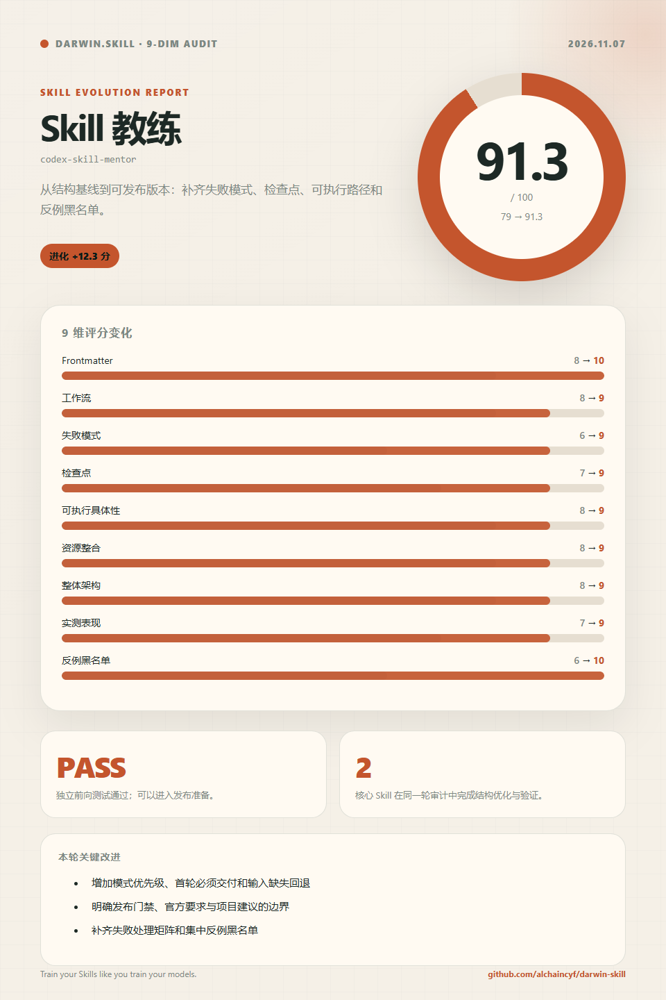

# Codex Skill Mentor

> 零基础做出第一个能被 Codex 正确发现、执行、验证和发布的 Skill。



`codex-skill-mentor` 是一个原创的「Skill 教练」。它不一次性倾倒课程，而是先诊断你的真实任务，再带你完成最小可运行版本，最后用真实请求验证并发布到 GitHub。

## English Summary

A project-based Codex skill mentor for beginners. It diagnoses a real task, guides the user through a minimal `SKILL.md`, validates the package, forward-tests the behavior, and prepares a GitHub release.

## 适用场景

- 你有一个 Skill 想法，但不知道从哪里开始。
- 你已经写了 `SKILL.md`，但它总是不触发或指令不可执行。
- 你想知道什么时候需要 `scripts/`、`references/` 或 `assets/`。
- 你准备把 Skill 发布到 GitHub，但缺少验证和 Release 清单。

不适用于：单纯学习编程、生成一次性提示词、替代官方运行时文档。

## 安装

### 方式一：skills CLI

```bash
npx skills add youmeng96/codex-skill-mentor -a codex
```

### 方式二：手动安装

```bash
git clone https://github.com/youmeng96/youmeng96/codex-skill-mentor.git ~/.codex/skills/codex-skill-mentor
```

Windows PowerShell：

```powershell
git clone https://github.com/youmeng96/youmeng96/codex-skill-mentor.git "$HOME\.codex\skills\codex-skill-mentor"
```

安装后重新打开 Codex 任务，让 Skill 被重新扫描。

## 快速开始

```text
Use $codex-skill-mentor to help me build a skill that turns meeting notes into action items.
```

也可以直接说：

```text
我零基础，想做一个自动整理会议纪要的 Skill。
```

教练会先确认任务、使用者和成功标准，再推进到一个实际产物。

## 五种模式

| 模式 | 输入 | 输出 |
|---|---|---|
| 诊断 | 模糊想法 | 一句目标、成功标准、排除边界 |
| 带练 | 明确需求 | 最小 `SKILL.md` 和验证请求 |
| 评审 | 已有 Skill | 评分、关键问题、可直接采用的修复 |
| 发布 | 已通过验证的 Skill | README、许可证、CI、Release 清单 |
| 答疑 | 单个概念问题 | 一个解释和一个当前任务相关的例子 |

完整课程见 [`references/curriculum.md`](references/curriculum.md)，评分表见 [`references/evaluation-rubric.md`](references/evaluation-rubric.md)。

## 本地验证

```bash
python -m pip install pyyaml
python scripts/validate_skill.py .
python -m unittest discover -s tests -v
```

验证器检查：

- frontmatter 和必填字段。
- 名称格式及目录一致性。
- description 长度和 TODO 占位符。
- `agents/openai.yaml` 的基本结构。
- 资源目录类型。

它不证明 Skill 的行为正确。至少用三个真实请求做前向测试。

## 仓库结构

```text
codex-skill-mentor/
├── SKILL.md
├── agents/openai.yaml
├── references/
│   ├── curriculum.md
│   ├── evaluation-rubric.md
│   ├── forward-test-results.md
│   └── sources.md
├── assets/
│   ├── hero-preview.png
│   ├── darwin-score.png
│   ├── minimal-skill-template/
│   ├── icon-small.svg
│   └── icon-large.svg
├── scripts/validate_skill.py
├── tests/test_validate_skill.py
├── test-prompts.json
├── README.md
├── CHANGELOG.md
└── LICENSE
```

## 设计原则

1. Skill 改变行为，不是堆叠文档。
2. `description` 是路由器，不是宣传语。
3. 先完成最小可运行版本。
4. 条件性细节渐进披露。
5. 用真实任务验证，而不是自我评分。

## 来源与归属

结构基线来自 OpenAI bundled `skill-creator`。教学方法受到花叔 [女娲 · Skill造人术](https://github.com/alchaincyf/nuwa-skill) 的主题 Skill 与提炼框架启发。本项目使用原创教练人格，不冒充原作者，也不代表原作者背书。

详细来源与复核要求见 [`references/sources.md`](references/sources.md)。

## 已知限制

- Skill 是否触发取决于运行时、描述和真实请求，不能保证每次都命中。
- 结构验证不能替代行为测试。
- 运行时文档可能变化；发布新版本前应重新核对官方链接。

## License

[MIT](LICENSE)

## Quality Gate



发布前使用 Darwin 9 维 rubric 做结构审计与独立前向测试，重点检查失败模式、检查点、可执行具体性和反例黑名单。当前审计为 91.3/100，独立测试结论为 PASS。
